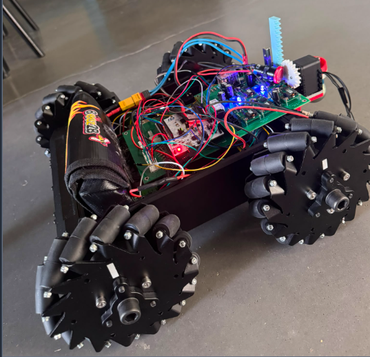
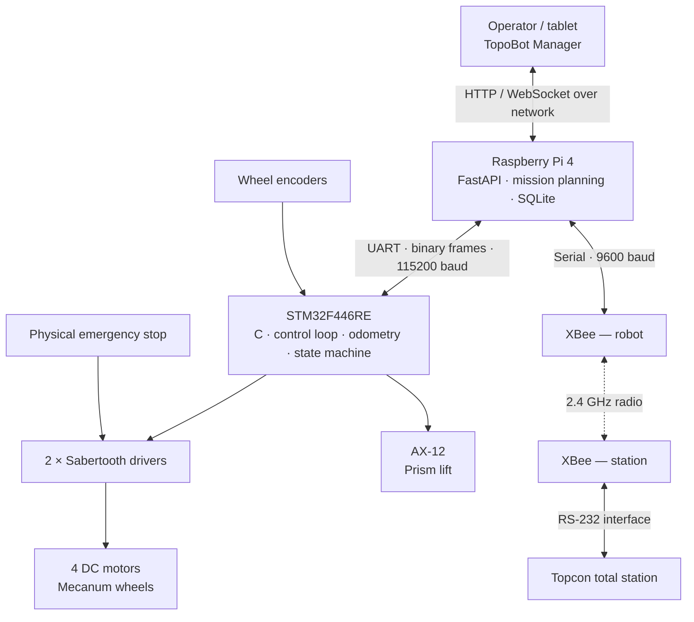
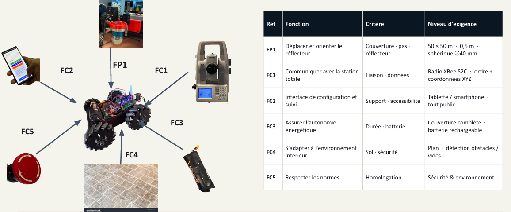
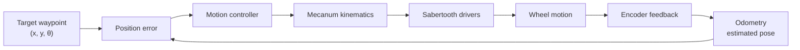
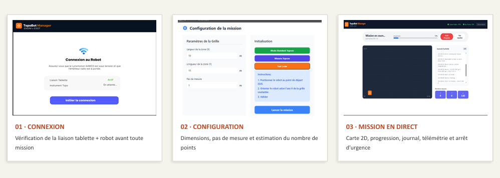
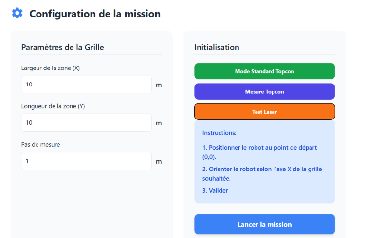
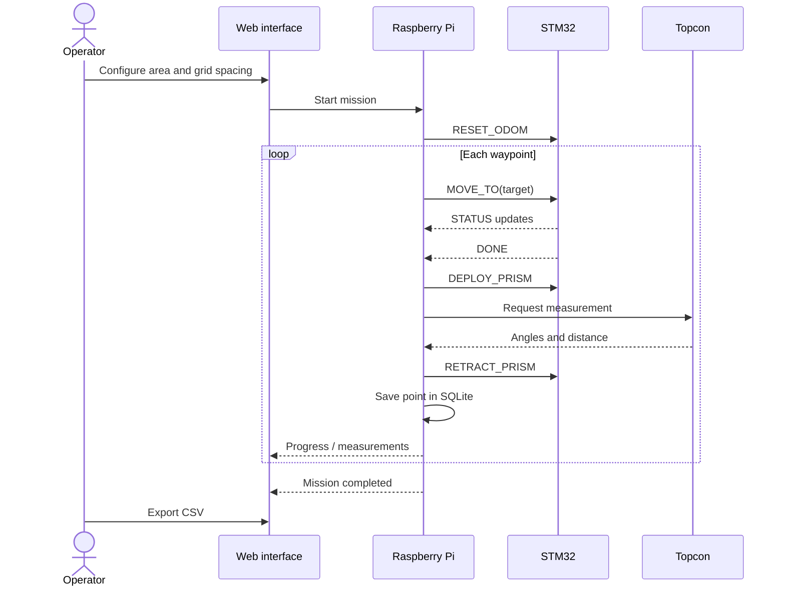
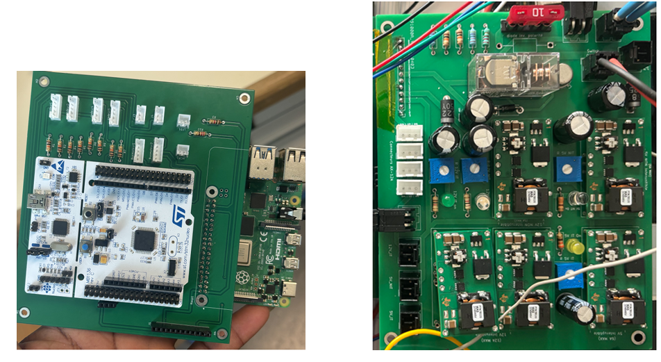
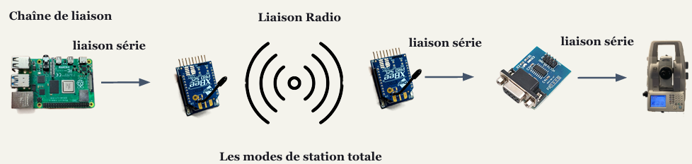

# TopoBot — Autonomous Topographic Survey Robot

<p align="center">
  <strong>Holonomic mobile robot for automated topographic surface-flatness surveys</strong><br>
  ENSIM × ESGT · Four-student engineering project · 2025–2026
</p>

<p align="center">
  
</p>

<p align="center">
  <a href="assets/video/0611.mp4"><strong>▶ Watch the physical robot demo</strong></a> ·
  <a href="docs/report/Rapport_final.pdf">Final report</a> ·
  <a href="docs/technical/">Technical documentation</a>
</p>

<p align="center">
  <strong>C · STM32F446RE · STM32CubeIDE · Raspberry Pi 4 · Python · Mecanum · Encoders · UART · XBee · KiCad</strong>
</p>

> **Prototype status:** core hardware and software subsystems have been integrated and exercised in limited-scale testing. Full 50 m × 50 m autonomous surveying, calibrated positioning accuracy and production-grade reliability **have not been demonstrated**.

## Overview

**TopoBot** is a mobile robotics project developed to reduce the repetitive manual work involved in topographic surface-flatness inspections. Instead of moving a survey reflector by hand between measurement points, an operator configures a grid and supervises a robotic sequence.

The intended cycle is to **navigate to a waypoint → stabilize → deploy the prism → acquire a total-station measurement → retract the prism → record the result → continue**. The survey points are ordered along a *boustrophedon* (serpentine) trajectory to limit unnecessary travel.

The platform combines **embedded C control, mechanical kinematics, physical validation, Python-based mission supervision, electronic interfaces and topographic instrumentation**.

### At a glance

| Component | Implementation |
|---|---|
| Mobile platform | Lynxmotion A4WD3, four Mecanum wheels and four DC motors |
| Low-level control | STM32 Nucleo-F446RE, embedded C / STM32 HAL |
| High-level supervision | Raspberry Pi 4, Python / FastAPI |
| Motor power | Two Sabertooth motor controllers |
| Motion feedback | Four installed incremental encoders; full-channel validation remains necessary |
| Prism positioning | Dynamixel AX-12 and rack-and-pinion mechanism |
| Survey instrument | Robotic Topcon total station |
| Wireless station link | Two XBee S2C modules and serial/RS-232 interface |
| User application | TopoBot Manager (React frontend, FastAPI backend) |
| Recorded data | SQLite and CSV export |
| Control-loop design | 100 Hz, as documented in the STM32 firmware |
| Team | Four engineering students |

**Design objective:** a configurable survey area up to **50 × 50 m**, with a nominal **0.5 m measurement step**. These values are requirements, **not validated field performance**.

---

## 1. My contribution — kinematics, motion control and physical testing

I worked in a four-person team, with a primary focus on the **robot movement subsystem**:

- **Mecanum kinematics:** worked on converting longitudinal, lateral and angular motion requests into wheel-speed and direction commands.
- **Embedded control:** contributed to movement-command implementation and integration on the STM32-controlled robot.
- **Physical tests:** checked individual wheel behavior, straight-line and lateral motion, and investigated unexpected rotation during nominally straight trajectories.
- **Feedback and odometry:** took part in encoder acquisition checks, motion-feedback analysis and positioning tests.
- **System integration:** contributed to testing the interaction between movement commands and the wider robot mission, including the prism mechanism.

### A concrete engineering problem

In early physical tests, the robot tended to rotate slightly when commanded to move straight ahead. We tested wheel directions individually, checked the Mecanum motion combinations and compared the expected and observed behavior. This highlighted the limits of open-loop control and the need for reliable encoder feedback and closed-loop adjustment.

**What I learned:** embedded software should be validated on the actual hardware with repeatable tests and recorded observations, not judged only by whether the program runs.

> This is a team project. Other team members led the supervision/HMI, radio and Topcon communication, electronics and custom PCB work. See [Team & credits](#10-team--credits).

---

## 2. System architecture

The design separates **mission orchestration** from **time-critical motion control**.





**Responsibilities:**

- **Raspberry Pi:** generate waypoints, send motion orders, communicate with the station, store measurements, publish mission updates and serve the web application.
- **STM32:** decode commands, acquire encoder feedback, estimate motion, drive motors and execute the embedded state machine.
- **Topcon:** perform the actual topographic measurement; the Raspberry Pi is not a substitute for the station.

The emergency stop must be tested physically before operating the prototype. An application-level stop is not a substitute for the hardware stop.

---

## 3. Mecanum mobility and embedded control

Four Mecanum wheels allow longitudinal, lateral and rotational movement. The firmware transforms motion requests into individual motor commands.

| Desired motion | Front left | Front right | Rear left | Rear right |
|---|:---:|:---:|:---:|:---:|
| Forward | + | + | + | + |
| Backward | − | − | − | − |
| Left strafe | − | + | + | − |
| Right strafe | + | − | − | + |
| Left rotation | − | + | − | + |
| Right rotation | + | − | + | − |

*The sign table is a diagnostic convention: actual signs depend on motor wiring and wheel mounting and must be confirmed on the robot.*

### Control workflow



The firmware includes separate modules for Mecanum motion, odometry, PID/control, serial communication, prism actuation and safety. See the source files directly:

- [`mecanum.c`](firmware/stm32/Core/Src/mecanum.c) — wheel-motion logic and motor commands
- [`odometry.c`](firmware/stm32/Core/Src/odometry.c) — encoder-based motion estimation
- [`pid.c`](firmware/stm32/Core/Src/pid.c) — control routines
- [`robot_control.c`](firmware/stm32/Core/Src/robot_control.c) — motion sequencing and state logic
- [`protocol.c`](firmware/stm32/Core/Src/protocol.c) — host/controller communications
- [`ax12.c`](firmware/stm32/Core/Src/ax12.c) — prism servomotor interface

**Important limitation:** the encoder channels and wheel-to-timer mapping require complete revalidation. Accordingly, the existence of an odometry/control module must not be confused with demonstrated high-precision positioning.

---

## 4. Raspberry Pi ↔ STM32 communication

The Raspberry Pi sends **high-level commands**; it does not directly generate real-time motor actuation.

Typical binary frame format:

```text
+-------+-----+-----+----------------+-----+
| START | CMD | LEN | PAYLOAD        | XOR |
+-------+-----+-----+----------------+-----+
   0xAA  1 B   1 B     LEN bytes      1 B
```

The last byte is an **XOR checksum**, not a polynomial CRC. It is calculated over the command, length and payload bytes. Payload layout and command codes must match the actual firmware version.

| Command | Purpose |
|---|---|
| `MOVE_TO(x, y, theta)` | Request movement toward a target pose |
| `STOP` | Request an immediate software stop |
| `RESET_ODOM` | Reset the local odometry origin |
| `GET_STATUS` | Request state and motion feedback |
| `DEPLOY_PRISM` | Lower the reflector for measurement |
| `RETRACT_PRISM` | Lift the reflector before movement |

The STM32 can emit acknowledgements, state/telemetry messages, completion notifications and error responses. The mission coordinator waits for movement completion before progressing to the next waypoint.

[Read the protocol documentation](docs/technical/firmware/Protocole_Communication.md).

---

## 5. Survey workflow and user application

TopoBot Manager supports an operator workflow from connection to mission monitoring.






### Nominal mission sequence



This is the **nominal system design**, not evidence that an entire large-area campaign has been successfully completed.

The backend source lives in [`software/topobot-manager/backend/main.py`](software/topobot-manager/backend/main.py), and the frontend code in [`software/topobot-manager/frontend/src/`](software/topobot-manager/frontend/src/).

### Data records

The stored/exported record includes a point ID, timestamp, local `X/Y` coordinates and the station's horizontal angle (`HZ`), vertical angle (`V`) and distance (`DIST`). These measurements should not be described as directly measured Cartesian `X/Y/Z` coordinates without a documented conversion and reference frame.

---

## 6. Electronics, prism and total station

### Custom control electronics

A custom control PCB was designed with KiCad, manufactured and integrated into the prototype. The previous power board was reused.



- [KiCad schematic and PCB](hardware/control-board/Kicad/)
- [Manufacturing files](hardware/control-board/manufacturing/gerbers/)

### AX-12 prism mechanism

An AX-12 servomotor moves a rack-and-pinion mechanism to deploy and retract the reflector. The actuator is synchronized with the stop-and-measure sequence, so the reflector can be positioned while the robot is stationary.

### Topcon / XBee radio chain



```text
Raspberry Pi --serial--> XBee #1 ~~radio~~ XBee #2 --RS-232--> Topcon
```

The original XBee setup was documented around **9600 baud** and **PAN ID B332**. Both devices' current configuration and physical serial interface should be checked before field use. Radio interruptions were observed during testing; range and reliability on a 50 × 50 m area are **not validated**.

---

## 7. Testing, observations and limitations

| Item | Evidence / current assessment |
|---|---|
| Individual wheel direction tests | Carried out on the physical prototype |
| Longitudinal and lateral movement | Demonstrated in limited-scale testing |
| Unwanted rotation while translating | Observed and investigated during hardware tests |
| STM32/Raspberry Pi serial protocol | Implemented; long-duration robustness still to validate |
| Encoder feedback / odometry | Implemented with unresolved channel/calibration checks |
| Motion control | Implemented; tuning and drift require more work |
| AX-12 deployment / retraction | Integrated and exercised |
| Web supervision and mission orchestration | Implemented / exercised on the prototype |
| XBee / Topcon interaction | Exercised; intermittent radio losses observed |
| Full calibrated 50 m × 50 m survey | **Not demonstrated** |
| Obstacle and drop detection | **Not operational in final prototype** |

### Why there are no “± X mm” accuracy claims here

A positioning-accuracy figure would require a documented measurement protocol: commanded distances, independent ground truth, repetitions, environmental conditions, errors and uncertainty. The current repository documentation does not establish a reliable consolidated positioning tolerance for a complete survey.

Detailed documents:

- [Odometry and encoders](docs/technical/advanced/07_odometrie_encodeurs_complet.pdf)
- [Motion control / PID](docs/technical/advanced/08_asservissement_pid_complet.pdf)
- [Tests and validation](docs/technical/advanced/09_tests_et_validation_complet.pdf)
- [Pre-test safety checklist](docs/technical/advanced/12_checklist_securite_tests.pdf)

---

## 8. Build, flash and run

> **Hardware-dependent project.** The commands below document a starting point; they are **not a claim of a verified one-command installation**. Confirm pinout, power and serial connections using the hardware documentation and test emergency-stop behavior before enabling the motors.

### STM32 firmware

1. Install **STM32CubeIDE** and connect the Nucleo-F446RE by ST-Link USB.
2. Open the project at [`firmware/stm32/`](firmware/stm32/), which contains `.project`, `.cproject` and [`ProjetRobot.ioc`](firmware/stm32/ProjetRobot.ioc).
3. Review the board configuration, build the project and flash it via ST-Link.
4. Verify serial communication and the motor-output configuration before applying drive power.

When modifying `.ioc`, preserve custom code in the STM32CubeMX `USER CODE` sections and recheck peripheral settings after regeneration.

### Python backend on the Raspberry Pi

```bash
git clone https://github.com/Mickael235/topobot.git
cd topobot/software/topobot-manager/backend
python3 -m venv .venv
source .venv/bin/activate
pip install -r requirements.txt
```

Check the actual serial-device paths on the Pi before starting:

```bash
ls -l /dev/serial/by-id/
ls -l /dev/ttyUSB*
```

Then run the FastAPI app:

```bash
uvicorn main:app --host 0.0.0.0 --port 8000
```

The backend is intended to serve the built frontend when the corresponding build files are available.

### Frontend build status

The repository contains React/Vite source files in [`software/topobot-manager/frontend/src/`](software/topobot-manager/frontend/src/) but **does not currently include a `package.json` in that folder**. Consequently, a clean `npm install && npm run build` procedure cannot yet be guaranteed from the published repository alone. Add and verify the project's dependency manifest and lockfile before documenting a reproducible frontend build.

For hardware-specific instructions, consult [Firmware documentation](docs/technical/firmware/README.md) and [Raspberry Pi documentation](docs/technical/raspberry-pi/README.md). Some documentation retains historical folder names; use the paths in this repository as the source of truth.

---

## 9. Repository and technical documentation

```text
topobot/
├── assets/
│   ├── images/                  # Robot, hardware, UI and diagrams
│   └── video/0611.mp4           # Physical prototype demo
├── docs/
│   ├── report/                  # Project reports
│   ├── presentation/            # Defense / slides
│   └── technical/               # Engineering documentation
├── firmware/stm32/              # STM32CubeIDE project and C modules
├── hardware/control-board/      # KiCad design and Gerbers
└── software/
    ├── raspberry-pi/            # Other Pi scripts / station interface
    └── topobot-manager/
        ├── backend/             # FastAPI application
        └── frontend/            # React source
```

### Recommended reading order

1. [Quick start](docs/technical/overview/00_Demarrage_Rapide.md)
2. [Firmware modules](docs/technical/firmware/Modules.md)
3. [Binary protocol](docs/technical/firmware/Protocole_Communication.md)
4. [Raspberry Pi and backend](docs/technical/raspberry-pi/README.md)
5. [Topcon instrument](docs/technical/raspberry-pi/Station_Topcon.md)
6. [Calibration and troubleshooting](docs/technical/troubleshooting/06_Calibration_Depannage.md)
7. [Final project report](docs/report/Rapport_final.pdf)
8. [Project presentation](docs/presentation/TopoBot_Soutenance_FR_complete%20%281%29.pptx.pdf)

---

## 10. Team & credits

**ENSIM × ESGT — Le Mans University · Academic year 2025–2026**

| Contributor | Main focus |
|---|---|
| Bénéwindé Kontiebo | Project coordination, supervision and HMI |
| **Michael Essomba** | **Mecanum kinematics, movement control and testing; AX-12 contribution** |
| Arsène Nguenang Youkap | Electronics, PCB design and hardware integration |
| Aymane Fariss | XBee communication and total-station interface |

The inherited mechanical and power platform, along with previous cohorts' work, helped make this prototype possible.

### Project budget

- Allocated: **€500**
- Reported expenditure: **€318.26**
- Remaining: **€181.74**

---

## 11. Engineering challenges and future work

1. **Encoder validation:** confirm all four channels, their signs and wheel-to-timer assignments.
2. **Odometry calibration:** determine wheel and encoder parameters experimentally and quantify drift.
3. **Closed-loop tuning:** refine motion response and test repeatability on forward and lateral trajectories.
4. **Station-based correction:** develop odometry/total-station fusion with well-defined coordinate frames.
5. **Radio robustness:** assess XBee range, retry handling and alternative communication solutions.
6. **Safety:** add obstacle/drop sensing, protect wiring and retain supervised operation.
7. **Repeatable validation:** run progressively larger grids and publish a reproducible accuracy test plan.
8. **Reproducible software build:** publish the frontend manifest, environment configuration and startup scripts.

**Project outcome:** TopoBot demonstrates the integration of a mobile embedded control platform with a topographic measurement workflow. The next engineering step is not to claim full autonomy, but to make the existing prototype **more measurable, reproducible, robust and safe**.
